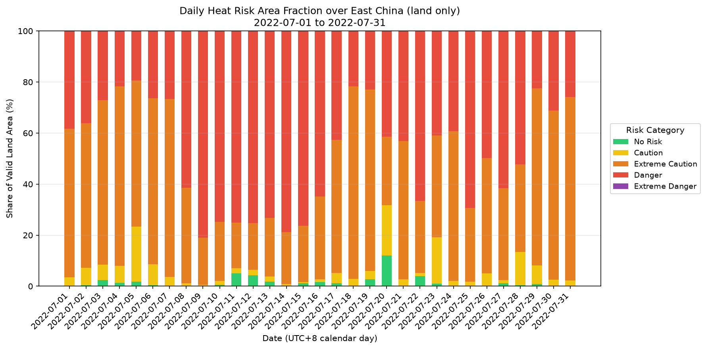
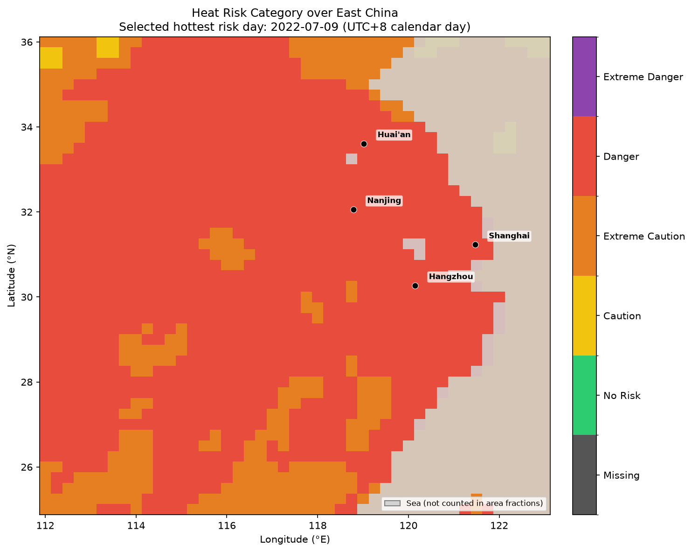
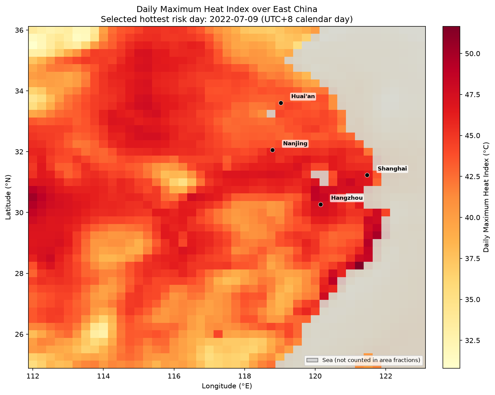
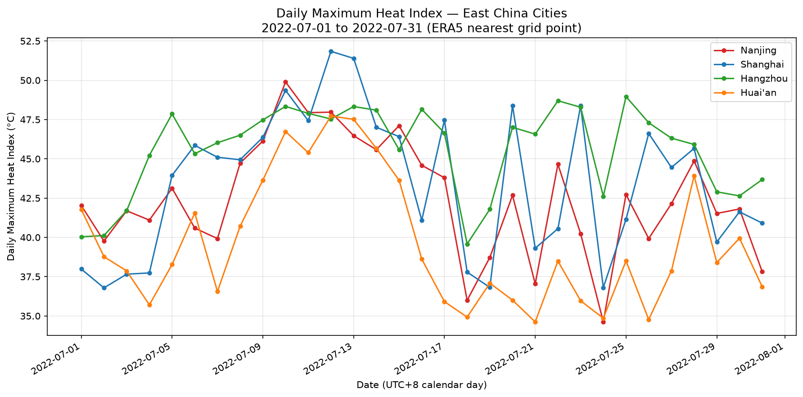

# East China Humid Heat Risk

This project is an atmospheric data science workflow for analyzing humid heat risk over East China using ERA5 hourly single-level reanalysis data.

The analysis is a **full-month July 2022 case study** (v0.2), now re-run with the corrected v0.3 methods: NOAA/WPC heat index, risk area fractions over land only, Beijing-time calendar days, and explicit handling of missing data. It demonstrates a reproducible pipeline for downloading ERA5 data, preprocessing 2m temperature and 2m dewpoint temperature, calculating relative humidity and heat index, classifying humid heat risk levels, comparing selected city points, and visualizing spatial risk patterns.

This project is not intended to make long-term climate trend claims at the current stage. Instead, it focuses on building a clean, reproducible, and extensible workflow that can later be scaled to seasonal, annual, or multi-year humid heat risk analysis.

## Project Status

- **v0.1:** 7-day workflow test, 2022-07-01 to 2022-07-07.
- **v0.2:** Full-month July 2022 case study, 2022-07-01 to 2022-07-31.
- **v0.3 (in progress):** phase 1 is done: a single config-driven pipeline with tests (1a) and the method fixes (1b). The results and figures below are the v0.3 outputs. Next: multi-year summers (phase 2) and a machine learning module (phase 3). See [docs/ROADMAP.md](docs/ROADMAP.md).

## Study Area and Period

**Region:** East China sample domain  
**Longitude:** 112°E to 123°E  
**Latitude:** 25°N to 36°N  
**Period:** 2022-07-01 to 2022-07-31  
**Temporal resolution:** Hourly ERA5 data  

Selected city points:

- Nanjing: 32.06°N, 118.79°E
- Shanghai: 31.23°N, 121.47°E
- Hangzhou: 30.27°N, 120.15°E
- Huai'an: 33.61°N, 119.02°E

## Data

The project uses ERA5 hourly single-level reanalysis data from the Copernicus Climate Data Store.

Variables used:

- 2m temperature
- 2m dewpoint temperature
- land-sea mask (time-invariant; one file per region, used to restrict area fractions to land)

Large NetCDF files are intentionally excluded from Git tracking using `.gitignore`. The repository keeps scripts, figures, reports, and processed CSV outputs, while raw and processed NetCDF files are reproducible from the workflow.

## Methods

The workflow includes the following steps:

1. Download ERA5 hourly 2m temperature and 2m dewpoint temperature (including the last 8 UTC hours of the day before the period, see below), and the ERA5 land-sea mask.
2. Convert temperature and dewpoint from Kelvin to Celsius.
3. Calculate relative humidity from temperature and dewpoint.
4. Calculate the hourly NOAA heat index (see below).
5. Extract daily maximum temperature and heat index over Beijing calendar days (UTC+8; UTC days in the `v0.1`/`v0.2` configs).
6. Compare city-level daily maximum temperature and heat index.
7. Classify humid heat risk levels.
8. Calculate latitude-weighted area fractions for each risk category, over land only.
9. Generate regional time series, city comparison figures, stacked risk-fraction charts, and spatial maps (sea greyed out).

### Heat index

The heat index follows the NOAA/WPC algorithm ([equation page](https://www.wpc.ncep.noaa.gov/html/heatindex_equation.shtml)), with T in °F and RH in %:

1. Compute the simple formula `HI = 0.5 * (T + 61.0 + (T - 68.0) * 1.2 + RH * 0.094)`.
2. If the average of this value and T is at least 80 °F, use the Rothfusz regression instead, with NOAA's adjustments for RH < 13 % (80–112 °F) and RH > 85 % (80–87 °F). This applies at any humidity.
3. Otherwise the heat index is the simple formula itself.

The implementation is tested against the NWS heat index chart and against MetPy's `heat_index`. MetPy and the NWS online calculator use a slightly different switch (simple formula ≥ 79 °F); the two rules differ only between 25.0 and 27.3 °C at high humidity, by up to 1.3 °C. Up to v0.2 the regression was only used for RH ≥ 40 %, which overestimated the heat index in very dry air, underestimated it for RH between about 30 % and 40 %, and made it jump at RH = 40 % (see [reports/phase1b_method_changes.md](reports/phase1b_method_changes.md)).

### Daily values (Beijing time)

ERA5 timestamps are UTC. Daily values (daily maximum temperature, daily maximum heat index, daily mean RH, and everything derived from them) are computed over local calendar days set by `utc_offset_hours` in the config. The Beijing-time configs (`configs/*_bjt.yaml`, `utc_offset_hours: 8`) use **Beijing calendar days** (UTC+8, no daylight saving): Beijing day D runs from 16:00 UTC on D−1 to 15:00 UTC on D. Their download therefore also fetches 16:00–23:00 UTC of the day before the period (e.g. 2022-06-30 for July 2022) and merges it into the raw file. A local day is complete only if it holds exactly the 24 hourly time steps 00:00–23:00 local time, each once; duplicate or non-hourly time steps anywhere in the raw file stop the run with an error (they are never dropped silently). Incomplete days outside the period (the partial day after it) are dropped, and the run stops with an error if a day of the period is incomplete.

The v0.1/v0.2 configs (`sample_2022_07_01_07.yaml`, `july_2022.yaml`) keep UTC days (`utc_offset_hours: 0`) and the v0.2 raw files. The Beijing-time configs have their own file tag (`..._bjt`), so their raw, processed and figure files never mix with the UTC ones. Every CSV output has a `date` column (`YYYY-MM-DD`) holding these calendar days (up to v0.2 the city Tmax table called it `time`). Each run also writes `data/processed/run_info_<tag>.json`, which records its day definition (`UTC` or `UTC+8`) and the UTC hours of a day; the date axes and map titles of the figures name it too. The hourly fields in `humid_heat_<tag>.nc` keep their UTC timestamps.

## Heat Risk Classification

Daily maximum heat index is classified into the following categories:

| Category | Heat Index Range |
|---|---|
| No Risk | < 26.7°C |
| Caution | 26.7°C to 32.2°C |
| Extreme Caution | 32.2°C to 40.6°C |
| Danger | 40.6°C to 54.4°C |
| Extreme Danger | >= 54.4°C |
| Missing (code −1) | heat index missing |

Area-fraction statistics are calculated over **land grid cells only**, using latitude-based weighting with `cos(latitude)`. A grid cell counts as land where the ERA5 land-sea mask (the fraction of land in the cell, 0–1) is at least `land_sea_mask_threshold` in the config (0.5 in both configs); this excludes the East China Sea and the Yellow Sea, 22 % of the domain (cos(latitude) weighted). The same land area is used to pick the hottest risk day for the maps. The maps still show sea cells, greyed out. Regional-mean time series still average over all grid cells.

**Missing data.** Daily maximum and mean values are NaN for a grid cell if any of its hours that day is missing (no maxima over partial days). Such cell-days get category −1 "Missing", never "No Risk". They are left out of the area fractions and drawn in dark grey on the maps.

**Area-fraction table** (`data/processed/daily_heat_risk_area_fraction_<tag>.csv`): one row per day with `date`, the five category columns and `Valid Land Coverage`. The five category columns are percentages of the **valid land area** of that day (land cells with data, cos(latitude)-weighted), so they sum to 100 %. `Valid Land Coverage` is the valid share of the whole land area in %, 100 when nothing is missing. On a day without any valid land cell the five categories are empty (NaN) and the coverage is 0.

## Results: July 2022 (v0.3)

The headline results use **Beijing calendar days** (UTC+8, `configs/july_2022_bjt.yaml`), the local days of the study area. The same month with UTC days (`configs/july_2022.yaml`, the v0.2 day definition) is shown for comparison. All numbers come from the CSV tables in `data/processed/` (`*_2022_07_bjt.csv` and `*_2022_07.csv`). They describe one month of one year and say nothing about long-term trends.

**Land area in each risk category** (mean over the 31 days of the daily cos(latitude)-weighted land area fractions, %):

| Run | No Risk | Caution | Extreme Caution | Danger | Extreme Danger |
|---|---|---|---|---|---|
| **v0.3, Beijing days (headline)** | 1.4 | 5.0 | 45.6 | 48.0 | 0.0 |
| v0.3, UTC days | 1.7 | 5.2 | 45.2 | 48.0 | 0.0 |
| v0.2 (old heat index, land and sea, UTC days) | 4.1 | 7.8 | 50.8 | 37.3 | 0.0 |

- On average 48.0 % of the land area was in **Danger** (daily maximum heat index 40.6–54.4 °C) and 45.6 % in Extreme Caution. Extreme Danger (≥ 54.4 °C) was reached by a single grid cell on a single day (30.75°N, 121.25°E on 07-13; 0.06 % of the land).
- Part of the land was in Danger on every day, from 19.4 % (07-05) to 80.9 % (07-09).
- Danger was most widespread from **07-08 to 07-16**: nine consecutive days with more than 60 % of the land in Danger. 07-22, 07-25 and 07-27 also exceeded 60 %.
- **Hottest risk day** (largest Danger + Extreme Danger land share, used for the maps): **2022-07-09**, 80.9 % of the land.
- **Beijing vs UTC days:** the same period means (Danger 48.0 % in both) and the same hottest risk day. Daily Danger shares differ by only −1.5 to +2.2 percentage points: the afternoon maximum (about 14:00–16:00 Beijing time) falls on the same calendar date under both definitions.
- **v0.2 → v0.3:** the mean Danger share rises from 37.3 % to 48.0 %, mostly because the area fractions now count land only (the sea is 22 % of the domain and almost never reaches Danger); the heat index fix adds 0.9 points. See [reports/phase1b_method_changes.md](reports/phase1b_method_changes.md).

**City points** (nearest ERA5 grid point, Beijing days):

| City | Daily max heat index, mean (°C) | Highest (°C, date) | Days in Danger | Daily max 2m temperature, mean / highest (°C) |
|---|---|---|---|---|
| Nanjing | 42.5 | 49.9 (07-10) | 21 | 34.1 / 37.9 |
| Shanghai | 43.4 | 51.8 (07-12) | 21 | 34.1 / 38.3 |
| Hangzhou | 45.6 | 49.0 (07-25) | 28 | 36.4 / 40.0 |
| Huai'an | 39.6 | 47.7 (07-12) | 11 | 32.2 / 36.1 |

With UTC days the city values differ by at most 0.2 °C in the mean (Shanghai 43.5, Huai'an 39.8 °C) and one Danger day (Shanghai 22); the highest values are the same.

Limitations: one month of one year (no climatology or trend); ERA5 is a 0.25° reanalysis, so city values are grid-cell values, not station observations; the NOAA heat index assumes shade and light wind, and its risk thresholds were defined for the United States. The regional-mean time series (mean daily Tmax and heat index) are plain means over all grid cells, sea included and not area-weighted.

### Figures

Headline figures, Beijing days (`figures/v0.3_july_2022_bjt/`):









Each folder also holds the regional-mean daily Tmax and heat index series and the city Tmax comparison:

| Folder | Period | Days |
|---|---|---|
| `figures/v0.3_july_2022_bjt/` | July 2022 (headline) | Beijing (UTC+8) |
| `figures/v0.2_july_2022/` | July 2022 | UTC |
| `figures/v0.3_sample_7day_bjt/` | 2022-07-01 to 2022-07-07 | Beijing (UTC+8) |
| `figures/v0.1_sample_7day/` | 2022-07-01 to 2022-07-07 | UTC |

A folder name gives the version that introduced the run. All four runs now use the v0.3 methods: the v0.1 and v0.2 folders and CSVs were regenerated, and the old-method outputs remain in the git history (commit `851b496`).

## How to Run

```bash
python -m venv .venv
.venv\Scripts\activate          # Windows; on macOS/Linux: source .venv/bin/activate
pip install -r requirements.txt

# Download ERA5 (needs a CDS account and ~/.cdsapirc), then run every step
python -m src.pipeline --config configs/july_2022_bjt.yaml --download   # Beijing-time days
python -m src.pipeline --config configs/july_2022.yaml --download       # UTC days (v0.2 files)

# Re-run selected steps only
python -m src.pipeline --config configs/july_2022.yaml --steps classify_heat_risk plot_heat_risk_maps

# Tests
python -m pytest
```

Each run is described by one YAML file in `configs/` (period, region, cities, output names). To analyse another period, add a config file. Do not copy scripts.

## Repository Structure

```text
configs/                # One YAML file per run (v0.1 sample, v0.2 July 2022: UTC days; *_bjt: Beijing days)
data/
  raw/                  # Raw ERA5 NetCDF files, ignored by Git
  processed/            # Processed NetCDF files ignored by Git; CSV outputs and run_info JSON tracked
docs/                   # Roadmap
figures/                # Output figures, one folder per version
reports/                # Project summary and notes
src/
  pipeline.py           # Entry point: python -m src.pipeline --config ...
  config.py             # Loads a config and derives all file paths
  indices.py            # Unit conversion, relative humidity, heat index
  risk.py               # Risk categories and cos(latitude) area fractions
  era5_utils.py         # ERA5 coordinate/variable name detection
  <step>.py             # One module per workflow step
tests/                  # pytest unit and end-to-end tests
README.md
requirements.txt
```


