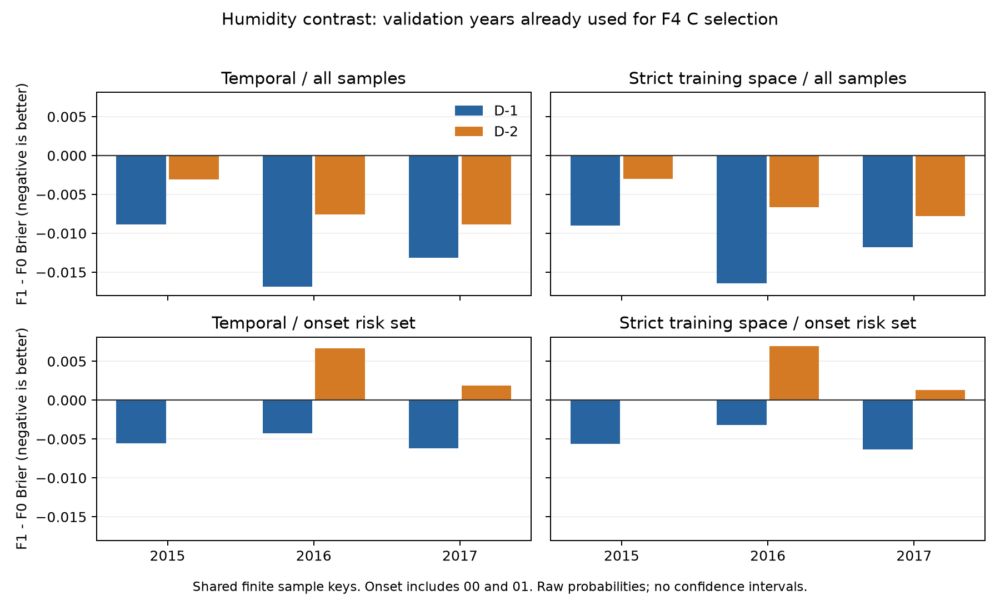

# 湿热概率历史回报：第二阶段特征与真实基线结果

本阶段完成2000–2019年完整特征和共同样本，以及2000–2014训练、2015–2017验证的有限真实基线。2018–2019只准备特征，未校准或评价；未打开2020–2024天气数值。以下为原始概率结果，训练指标是回代成绩，验证指标不能替代最终独立测试。

## 特征与样本

117列冻结特征已完成：C6/T27/M54/NT3/NM2/RT4/RM8/H13；F0=33、F1=87、F4=117列。真实小时均露点、Td/RH极值、12点夜间及20→07温差、3/7日汇总、季节背景和固定邻域均来自过去信息。HI标签由原计算精度的日HI生成，与特征矩阵float32存储转换独立；NetCDF保留各变量原计算dtype（日统计float32、夜间数组float64），无额外存储降精度。

每年普通时间范围132,720个共同样本，严格训练空间109,116个；两lag及全部模型使用各范围同一键。20年均无额外缺测剔除。严格空间仅1299个训练查询格，邻域来源保持1302个训练空间格，不递归删除来源。

2000试跑13.2秒，峰值工作集524.7MiB；20个正式年度提取共265.2秒。源文件共80个，均只读。

## 有限LR选择

每个范围仅F4/D−1比较C=0.01、0.1、1、10，使用2015/2016/2017逐年等权原始Brier选择；固定lbfgs、L2、不惩罚截距、max_iter=2000、tol=1e−6、2线程。选定C复用于F0/F1/F4及D−2，scaler只在训练样本拟合。

普通时间范围C=0.1；严格训练空间C=0.1。候选收敛记录和逐年选择分数见各范围`lr_selection_*.json`。

达到预设迭代上限而未收敛、已排除选择的候选：strict: C=1.0；strict: C=10.0。按冻结规则保留失败记录，未增加迭代或更换求解器。

实际搜索拟合8次：6次收敛、2次失败；连同固定参数复用共18次真实LR拟合，16次收敛、2次失败，导出12个LR模型。

选定参数后的全部固定复用臂均收敛；搜索失败候选未混入导出的模型和概率。

## 验证原始概率

Brier越低越好，AP越高越好。表中均为三个验证年等权均值；普通与严格范围样本不同，分数只在各自范围内比较。完整逐年训练/验证、混淆矩阵、事件率、余弦纬度敏感性与可靠度分箱见CSV。

### 全部共同样本

| scope | lag | model | mean_annual_brier | mean_annual_ap |
| --- | --- | --- | --- | --- |
| strict | 1 | logistic_F0 | 0.0926 | 0.7733 |
| strict | 1 | logistic_F1 | 0.0802 | 0.8114 |
| strict | 1 | logistic_F4 | 0.0754 | 0.8339 |
| strict | 1 | persistence | 0.1196 | 0.5890 |
| strict | 1 | seasonal | 0.1647 | 0.3766 |
| strict | 1 | seasonal_pooled | 0.1647 | 0.3766 |
| strict | 1 | transition | 0.0976 | 0.6717 |
| strict | 2 | logistic_F0 | 0.1169 | 0.6417 |
| strict | 2 | logistic_F1 | 0.1110 | 0.6496 |
| strict | 2 | logistic_F4 | 0.1089 | 0.6665 |
| strict | 2 | persistence | 0.1754 | 0.4494 |
| strict | 2 | seasonal | 0.1647 | 0.3766 |
| strict | 2 | seasonal_pooled | 0.1647 | 0.3766 |
| strict | 2 | transition | 0.1283 | 0.5477 |
| temporal | 1 | logistic_F0 | 0.0965 | 0.7847 |
| temporal | 1 | logistic_F1 | 0.0835 | 0.8188 |
| temporal | 1 | logistic_F4 | 0.0786 | 0.8408 |
| temporal | 1 | persistence | 0.1238 | 0.6041 |
| temporal | 1 | seasonal | 0.1466 | 0.5553 |
| temporal | 1 | seasonal_pooled | 0.1705 | 0.4042 |
| temporal | 1 | transition | 0.1009 | 0.6914 |
| temporal | 2 | logistic_F0 | 0.1210 | 0.6682 |
| temporal | 2 | logistic_F1 | 0.1145 | 0.6797 |
| temporal | 2 | logistic_F4 | 0.1124 | 0.6925 |
| temporal | 2 | persistence | 0.1788 | 0.4732 |
| temporal | 2 | seasonal | 0.1466 | 0.5553 |
| temporal | 2 | seasonal_pooled | 0.1705 | 0.4042 |
| temporal | 2 | transition | 0.1314 | 0.5763 |

### 新发生风险集：前日未发生，含负例00和正例01

| scope | lag | model | mean_annual_brier | mean_annual_ap |
| --- | --- | --- | --- | --- |
| strict | 1 | logistic_F0 | 0.0628 | 0.3122 |
| strict | 1 | logistic_F1 | 0.0577 | 0.3959 |
| strict | 1 | logistic_F4 | 0.0562 | 0.4350 |
| strict | 1 | persistence | 0.0802 | 0.0802 |
| strict | 1 | seasonal | 0.0840 | 0.1271 |
| strict | 1 | seasonal_pooled | 0.0840 | 0.1271 |
| strict | 1 | transition | 0.0724 | 0.1271 |
| strict | 2 | logistic_F0 | 0.0711 | 0.2238 |
| strict | 2 | logistic_F1 | 0.0739 | 0.2151 |
| strict | 2 | logistic_F4 | 0.0733 | 0.2233 |
| strict | 2 | persistence | 0.1273 | 0.1038 |
| strict | 2 | seasonal | 0.0840 | 0.1271 |
| strict | 2 | seasonal_pooled | 0.0840 | 0.1271 |
| strict | 2 | transition | 0.0812 | 0.1473 |
| temporal | 1 | logistic_F0 | 0.0668 | 0.3112 |
| temporal | 1 | logistic_F1 | 0.0615 | 0.3921 |
| temporal | 1 | logistic_F4 | 0.0601 | 0.4229 |
| temporal | 1 | persistence | 0.0854 | 0.0854 |
| temporal | 1 | seasonal | 0.0840 | 0.2231 |
| temporal | 1 | seasonal_pooled | 0.0895 | 0.1351 |
| temporal | 1 | transition | 0.0766 | 0.1351 |
| temporal | 2 | logistic_F0 | 0.0757 | 0.2225 |
| temporal | 2 | logistic_F1 | 0.0785 | 0.2176 |
| temporal | 2 | logistic_F4 | 0.0777 | 0.2261 |
| temporal | 2 | persistence | 0.1328 | 0.1125 |
| temporal | 2 | seasonal | 0.0840 | 0.2231 |
| temporal | 2 | seasonal_pooled | 0.0895 | 0.1351 |
| temporal | 2 | transition | 0.0853 | 0.1585 |

## 湿度对照与适用界限

| scope | lag | risk_set | mean_delta_F1_minus_F0 | years_improving | validation_years |
| --- | --- | --- | --- | --- | --- |
| strict | 1 | all | -0.0124 | 3 | 3 |
| strict | 1 | onset | -0.0051 | 3 | 3 |
| strict | 2 | all | -0.0058 | 3 | 3 |
| strict | 2 | onset | 0.0028 | 0 | 3 |
| temporal | 1 | all | -0.0130 | 3 | 3 |
| temporal | 1 | onset | -0.0053 | 3 | 3 |
| temporal | 2 | all | -0.0065 | 3 | 3 |
| temporal | 2 | onset | 0.0029 | 0 | 3 |

需要保留的限制：普通范围D−2新发生风险集的F1−F0平均Brier差为+0.0029，改善年份为0/3。在本轮固定LR设置和未校准验证概率下，当前结果不支持湿度稳定改善新发生；D−1的改善不能抵消D−2反例，总体分数改善也不能直接推广为新发生识别的稳定收益。

F1−F0差值仅描述本轮验证上的湿度对照，负值表示Brier改善。相同验证年已用于F4的C选择，不是未见评估；此处未计算置信区间或宣称显著性，也不解释成独立测试支持或因果机制。严格空间验证仍在训练空间，尚未检验留出地区迁移。D−2分组所用D−1标签仅供事后评价。当前p≥0.5只是固定研究阈值，未生成10%校准预算阈值。

## 计算与证据

模型运行总计3279.8秒，进程峰值工作集4.95GiB。34 passed, 3 warnings in 6.56s

- 年度特征及SHA：`data/probability_phase2/features/YYYY/run.json`、`feature_counts_yearly.csv`、`input_manifest.json`。
- 指标与模型：`data/probability_phase2/experiments/run1/metrics_yearly.csv`、`metrics_summary.csv`、`models/`、`experiments.json`。
- 预测采用每年NPZ与不可变网格表的因子化表示；`prediction_schema.json`给出样本ID、起报/目标窗、最大输入时间和缺失校准字段的重建规则。
- 未提交大数组或隔离依赖；版本化JSON/CSV、输入和输出SHA以及重现命令保留。
- 首次2000运行在写资源报告时遇到Windows ctypes句柄错误，数值产物保留在`2000-r1-incomplete`；修复后正式2000重跑成功，其后数值流程未变。

下一阶段先完成尚未执行的预设模型与消融选择并冻结，再依协议进行概率校准、告警规则及最终测试。本轮未运行LightGBM或F0P/F1P等剩余对照，不据本报告直接开放最终测试。
