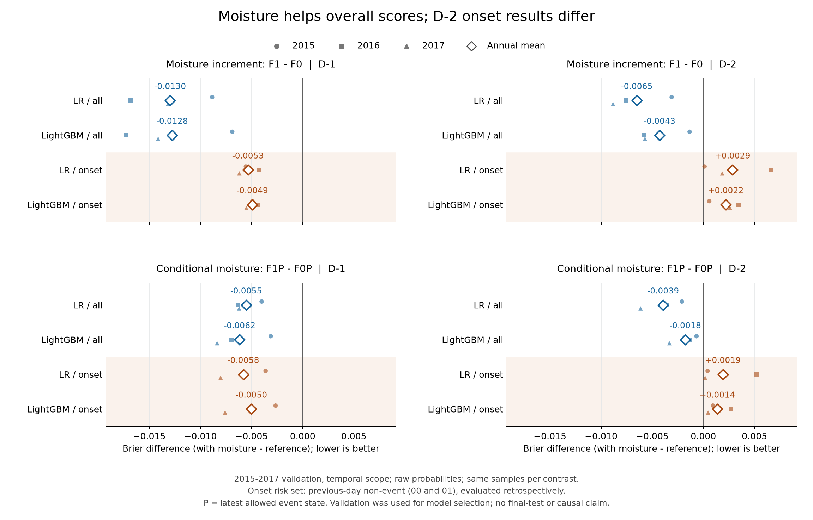
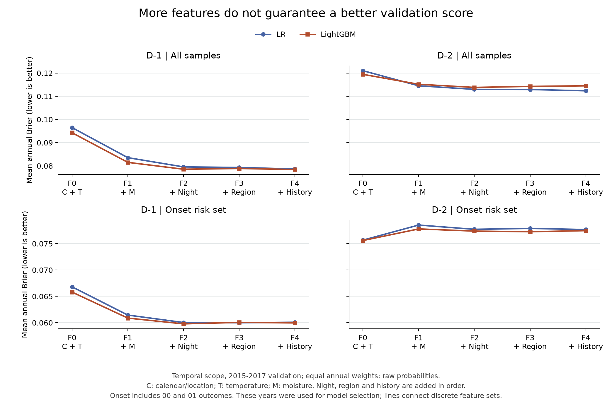

# 第三阶段 LightGBM：完整验证矩阵与消融结果

本报告只汇总已完成批次。全部58次正式拟合、44个导出模型的目标不变；缺项明确列为pending，不根据分数删除实验。2018–2019及2020–2024均不读入本轮模型，不校准、不作最终测试或空间迁移声明。

当前正式完成/已拟合58次，明确失败0次，中断未完成0次，尚未执行0次；已导出44/44个模型。另有1次100轮训练期资源pilot，不计入正式58次。

## 冻结方法与资源

复用第二阶段117列float32与原始标签/共同样本，不重提取。CPU单线程、固定种子，训练期独立建分箱；验证Dataset以训练Dataset为reference。仅各范围F4/D−1的八个候选可用验证binary logloss早停100轮，最多2000轮；完成全候选终态后按逐年等权Brier及预设复杂度规则选定。所有其他臂和D−2复用本范围赢家参数及最佳轮数，不再早停或选轮数。

首批树模型约3小时资源预算在首候选成绩出来前按pilot及迭代进度固定；达到预算不启动新拟合，当前拟合可结束。完整候选搜索未完成时不得声明赢家。严格树范围需要独立完整搜索，不能使用普通范围赢家代替。详细决定见`data/probability_phase3/execution_batches.json`。

第二批为独立登记的资源调度：开始 2026-11-05T20:53:27.4226837+00:00，预算 2 小时，首批原截止不变。启动前确认磁盘与任务冲突门槛；复用已有结果，继续原预设矩阵，不按分数增删实验。记录见 `data/probability_phase3/execution_batch2.json`。

100轮pilot：训练1,990,800行×117列，总54.6秒，其中训练40.8秒，峰值工作集1.51GiB；没有验证输入或保留预测。

保留 3 次历史执行中断记录（`run1/interrupted_invocations`）；恢复后完成结果覆盖当前pending状态，历史记录不删除。中断不是已证明的数值失败；工具返回标签本身不能确定用户停止意图。

## 已完成候选

| scope | num_leaves | min_child_samples | reg_lambda | status | best_iteration | optimization_rounds | fit_seconds | validation_brier |
| --- | --- | --- | --- | --- | --- | --- | --- | --- |
| temporal | 7 | 100 | 1 | complete | 1280 | 1380 | 438.5966 | 0.0785 |
| temporal | 7 | 100 | 10 | complete | 1342 | 1442 | 455.1765 | 0.0785 |
| temporal | 7 | 500 | 1 | complete | 1238 | 1338 | 423.4286 | 0.0786 |
| temporal | 7 | 500 | 10 | complete | 1322 | 1422 | 453.0110 | 0.0784 |
| temporal | 15 | 100 | 1 | complete | 723 | 823 | 311.1406 | 0.0785 |
| temporal | 15 | 100 | 10 | complete | 667 | 767 | 295.2125 | 0.0784 |
| temporal | 15 | 500 | 1 | complete | 759 | 859 | 326.3573 | 0.0787 |
| temporal | 15 | 500 | 10 | complete | 561 | 661 | 257.8299 | 0.0786 |
| strict | 7 | 100 | 1 | complete | 998 | 1098 | 283.6547 | 0.0752 |
| strict | 7 | 100 | 10 | complete | 883 | 983 | 240.3868 | 0.0751 |
| strict | 7 | 500 | 1 | complete | 783 | 883 | 233.9430 | 0.0751 |
| strict | 7 | 500 | 10 | complete | 928 | 1028 | 267.8782 | 0.0751 |
| strict | 15 | 100 | 1 | complete | 467 | 567 | 182.2404 | 0.0755 |
| strict | 15 | 100 | 10 | complete | 539 | 639 | 202.0287 | 0.0754 |
| strict | 15 | 500 | 1 | complete | 476 | 576 | 183.7451 | 0.0754 |
| strict | 15 | 500 | 10 | complete | 457 | 557 | 168.2340 | 0.0755 |

选定参数（只列完整搜索的范围）：`report/selected_configurations.json`。训练轮数达到2000本身不等于失败；实际early-stopping最佳轮数与优化轮数分别保存。

## 同臂 LR 配对

| scope | lag | arm | risk_set | both_lags_available | tree_brier | lr_brier | delta_brier | bss_from_mean_annual_brier |
| --- | --- | --- | --- | --- | --- | --- | --- | --- |
| strict | 1 | F0 | all | True | 0.0909 | 0.0926 | -0.0017 | 0.0183 |
| strict | 1 | F0 | onset | True | 0.0621 | 0.0628 | -0.0007 | 0.0107 |
| strict | 1 | F0P | all | True | 0.0834 | 0.0852 | -0.0018 | 0.0211 |
| strict | 1 | F0P | onset | True | 0.0621 | 0.0635 | -0.0013 | 0.0211 |
| strict | 1 | F1 | all | True | 0.0785 | 0.0802 | -0.0017 | 0.0209 |
| strict | 1 | F1 | onset | True | 0.0572 | 0.0577 | -0.0005 | 0.0091 |
| strict | 1 | F1P | all | True | 0.0779 | 0.0799 | -0.0019 | 0.0244 |
| strict | 1 | F1P | onset | True | 0.0572 | 0.0580 | -0.0008 | 0.0139 |
| strict | 1 | F4 | all | True | 0.0751 | 0.0754 | -0.0002 | 0.0031 |
| strict | 1 | F4 | onset | True | 0.0560 | 0.0562 | -0.0002 | 0.0032 |
| strict | 2 | F0 | all | True | 0.1150 | 0.1169 | -0.0019 | 0.0159 |
| strict | 2 | F0 | onset | True | 0.0711 | 0.0711 | -0.0000 | 0.0006 |
| strict | 2 | F0P | all | True | 0.1124 | 0.1146 | -0.0021 | 0.0186 |
| strict | 2 | F0P | onset | True | 0.0720 | 0.0720 | 0.0000 | -0.0003 |
| strict | 2 | F1 | all | True | 0.1118 | 0.1110 | 0.0008 | -0.0072 |
| strict | 2 | F1 | onset | True | 0.0730 | 0.0739 | -0.0009 | 0.0116 |
| strict | 2 | F1P | all | True | 0.1114 | 0.1109 | 0.0005 | -0.0042 |
| strict | 2 | F1P | onset | True | 0.0731 | 0.0739 | -0.0009 | 0.0116 |
| strict | 2 | F4 | all | True | 0.1103 | 0.1089 | 0.0015 | -0.0134 |
| strict | 2 | F4 | onset | True | 0.0729 | 0.0733 | -0.0004 | 0.0059 |
| temporal | 1 | F0 | all | True | 0.0943 | 0.0965 | -0.0022 | 0.0230 |
| temporal | 1 | F0 | onset | True | 0.0658 | 0.0668 | -0.0010 | 0.0150 |
| temporal | 1 | F0P | all | True | 0.0873 | 0.0887 | -0.0015 | 0.0163 |
| temporal | 1 | F0P | onset | True | 0.0660 | 0.0675 | -0.0015 | 0.0218 |
| temporal | 1 | F1 | all | True | 0.0815 | 0.0835 | -0.0020 | 0.0243 |
| temporal | 1 | F1 | onset | True | 0.0609 | 0.0615 | -0.0006 | 0.0094 |
| temporal | 1 | F1P | all | True | 0.0811 | 0.0832 | -0.0021 | 0.0251 |
| temporal | 1 | F1P | onset | True | 0.0610 | 0.0617 | -0.0007 | 0.0111 |
| temporal | 1 | F4 | all | True | 0.0784 | 0.0786 | -0.0002 | 0.0028 |
| temporal | 1 | F4 | onset | True | 0.0600 | 0.0601 | -0.0001 | 0.0021 |
| temporal | 2 | F0 | all | True | 0.1195 | 0.1210 | -0.0016 | 0.0130 |
| temporal | 2 | F0 | onset | True | 0.0756 | 0.0757 | -0.0001 | 0.0010 |
| temporal | 2 | F0P | all | True | 0.1165 | 0.1183 | -0.0018 | 0.0151 |
| temporal | 2 | F0P | onset | True | 0.0763 | 0.0766 | -0.0003 | 0.0038 |
| temporal | 2 | F1 | all | True | 0.1152 | 0.1145 | 0.0006 | -0.0057 |
| temporal | 2 | F1 | onset | True | 0.0778 | 0.0785 | -0.0007 | 0.0094 |
| temporal | 2 | F1P | all | True | 0.1147 | 0.1144 | 0.0004 | -0.0033 |
| temporal | 2 | F1P | onset | True | 0.0777 | 0.0785 | -0.0008 | 0.0108 |
| temporal | 2 | F4 | all | True | 0.1145 | 0.1124 | 0.0022 | -0.0192 |
| temporal | 2 | F4 | onset | True | 0.0775 | 0.0777 | -0.0002 | 0.0027 |

差值为LightGBM−LR，负值表示Brier降低。完整逐年、全部预设臂与固定第二阶段LR_F4参考见report内CSV。`both_lags_available=False`表示未完成双lag配对，只提供可追溯记录，不据此作完整对照结论。

## 预设湿度对照

| scope | lag | risk_set | candidate | reference | both_lags_complete | mean_delta | years_improving |
| --- | --- | --- | --- | --- | --- | --- | --- |
| strict | 1 | all | F1 | F0 | True | -0.0124 | 3 |
| strict | 1 | all | F1P | F0P | True | -0.0055 | 3 |
| strict | 1 | onset | F1 | F0 | True | -0.0049 | 3 |
| strict | 1 | onset | F1P | F0P | True | -0.0049 | 3 |
| strict | 2 | all | F1 | F0 | True | -0.0032 | 3 |
| strict | 2 | all | F1P | F0P | True | -0.0010 | 2 |
| strict | 2 | onset | F1 | F0 | True | 0.0020 | 0 |
| strict | 2 | onset | F1P | F0P | True | 0.0010 | 1 |
| temporal | 1 | all | F1 | F0 | True | -0.0128 | 3 |
| temporal | 1 | all | F1P | F0P | True | -0.0062 | 3 |
| temporal | 1 | onset | F1 | F0 | True | -0.0049 | 3 |
| temporal | 1 | onset | F1P | F0P | True | -0.0050 | 3 |
| temporal | 2 | all | F1 | F0 | True | -0.0043 | 3 |
| temporal | 2 | all | F1P | F0P | True | -0.0018 | 3 |
| temporal | 2 | onset | F1 | F0 | True | 0.0022 | 0 |
| temporal | 2 | onset | F1P | F0P | True | 0.0014 | 0 |

strict 的 D−2 新发生对照 F1−F0：年度等权平均 Brier 差 +0.001953，3 年中 0 年改善。这一分组结果与全样本结果分别解释。

strict 的 D−2 新发生对照 F1P−F0P：年度等权平均 Brier 差 +0.001010，3 年中 1 年改善。这一分组结果与全样本结果分别解释。

temporal 的 D−2 新发生对照 F1−F0：年度等权平均 Brier 差 +0.002199，3 年中 0 年改善。这一分组结果与全样本结果分别解释。

temporal 的 D−2 新发生对照 F1P−F0P：年度等权平均 Brier 差 +0.001367，3 年中 0 年改善。这一分组结果与全样本结果分别解释。

所有结果来自已经用于选参的2015–2017验证年，没有独立测试或置信区间支持。F1−F0与F1P−F0P回答不同问题；历史事件状态已含湿度信息。第二阶段固定LR的D−2新发生反例仍保留，不能因树模型其他臂成绩较好而删除该证据。新发生风险集始终包含00和01，D−1标签在D−2中仅作事后评价。

## 待执行与恢复

尚有0个模型未完整导出，逐项范围/lag/臂/状态见`report/pending_models.csv`与`execution_registry.json`。

每个fit先保存模型文本及trained.json，再保存候选或逐年预测结果。恢复校验科学config、输入及参数指纹，已完成拟合不重训。初次搜索执行源快照已保存；后续资源守卫/调度补丁不改变科学参数，也不把已有模型作废。

后续仍先完成预设选择与消融并冻结，再校准及最终测试；本阶段没有授权直接开放最终年份。

Brier skill score (BSS) is 1 - BS_tree / BS_reference, with a zero reference score reported as NA. Annual tables use each year's scores; summary BSS uses the ratio of equal-weight mean annual scores, not the mean of annual BSS. Both same-arm LR and fixed phase-2 LR_F4 references are retained.

年度原始指标表保留样本数、事件率、Brier、AP、TP/FP/FN/TN及可靠性分箱。概率未经校准；分类使用预定研究阈值 p≥0.5，没有用验证结果选择业务阈值或10%告警预算。训练指标属于训练样本内重代入结果。

`report/simple_baseline_pairs_yearly.csv` 与汇总表保留相同范围、lag、年份和风险集下的持续性、季节气候概率及条件转移基线对照，包含 Brier 差和 BSS；这些基线直接复用第二阶段结果。

## 其余预设增量与消融

| scope | candidate | reference | D1_all | D1_onset | D2_all | D2_onset |
| --- | --- | --- | --- | --- | --- | --- |
| strict | F2 | F1 | -0.0027 | -0.0011 | -0.0011 | -0.0000 |
| strict | F2 | F2_minus_NM | -0.0000 | -0.0001 | -0.0005 | -0.0002 |
| strict | F2 | F2_minus_NT | -0.0011 | -0.0003 | -0.0006 | -0.0002 |
| strict | F3 | F2 | 0.0001 | 0.0001 | 0.0001 | -0.0000 |
| strict | F3 | F3_minus_RM | 0.0000 | 0.0000 | -0.0000 | -0.0000 |
| strict | F3 | F3_minus_RT | -0.0001 | -0.0002 | -0.0005 | -0.0000 |
| strict | F4 | F3 | -0.0007 | -0.0002 | -0.0006 | -0.0001 |
| temporal | F2 | F1 | -0.0030 | -0.0011 | -0.0014 | -0.0004 |
| temporal | F2 | F2_minus_NM | -0.0002 | -0.0003 | -0.0004 | -0.0001 |
| temporal | F2 | F2_minus_NT | -0.0011 | -0.0003 | -0.0006 | -0.0000 |
| temporal | F3 | F2 | 0.0003 | 0.0003 | 0.0004 | -0.0001 |
| temporal | F3 | F3_minus_RM | 0.0002 | 0.0002 | 0.0001 | -0.0001 |
| temporal | F3 | F3_minus_RT | 0.0002 | 0.0001 | -0.0004 | -0.0002 |
| temporal | F4 | F3 | -0.0004 | -0.0001 | 0.0003 | 0.0002 |

表中为候选减参照的年度等权平均 Brier 差，负值表示改善；只展示双 lag 均完成的对照。逐年变化、全部风险集和未完成状态保留在 report CSV 中，不由平均值推出稳定性或显著性。

## LR 消融补齐

本阶段新增 32 次固定 C=0.1 的 LR 拟合，成功 32 次，失败 0 次。与第二阶段已有 12 个模型合并，覆盖两个范围、两个 lag 的全部 11 个特征臂。训练与缩放仅使用 2000–2014；strict 验证仍为 T 查询格，不代表空间迁移检验。

加入最近允许事件状态后的湿度对照（F1P−F0P；负值表示改善）：

| scope | lag | risk_set | candidate | reference | mean_annual_brier_delta | years_improving | validation_years |
| --- | --- | --- | --- | --- | --- | --- | --- |
| strict | 1 | all | F1P | F0P | -0.0053 | 3 | 3 |
| strict | 1 | onset | F1P | F0P | -0.0055 | 3 | 3 |
| strict | 2 | all | F1P | F0P | -0.0036 | 3 | 3 |
| strict | 2 | onset | F1P | F0P | 0.0019 | 1 | 3 |
| temporal | 1 | all | F1P | F0P | -0.0055 | 3 | 3 |
| temporal | 1 | onset | F1P | F0P | -0.0058 | 3 | 3 |
| temporal | 2 | all | F1P | F0P | -0.0039 | 3 | 3 |
| temporal | 2 | onset | F1P | F0P | 0.0019 | 0 | 3 |

D−2 的新发生风险集在两个范围的平均 Brier 均变差；全样本改善不能替代新发生证据。该对照继续不支持湿度稳定改善 D−2 新发生预测。

补充 LR 最优臂按全样本年度等权 Brier 一次选择，记录于 `report/supplementary_lr_champions.json`。这是已见验证集上的附加比较，存在选择偏差；主参照仍为同臂 LR 和固定第二阶段 LR_F4。

## 核心湿度对照图

普通范围的两类预设对照、双 lag、LR 与 LightGBM，区分全样本和新发生风险集。负 Brier 差表示改善；这些验证年份已经参与模型选择，图中不作显著性推断。

[可导出 SVG](../figures/probability_phase3/moisture_validation_contrasts.svg)；逐年点、均值和输入指纹与图一同保存。

## 五层特征评分

普通范围 F0→F4 的 LR 与 LightGBM 验证评分，分别展示两个 lag 和全样本/新发生风险集。逐年点与年度等权均值均保留。

[可导出 SVG](../figures/probability_phase3/feature_ladder_validation.svg)；本图不代表独立测试或显著性检验。
