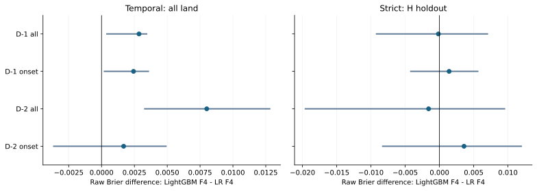
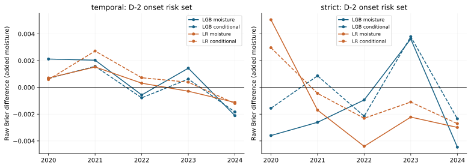
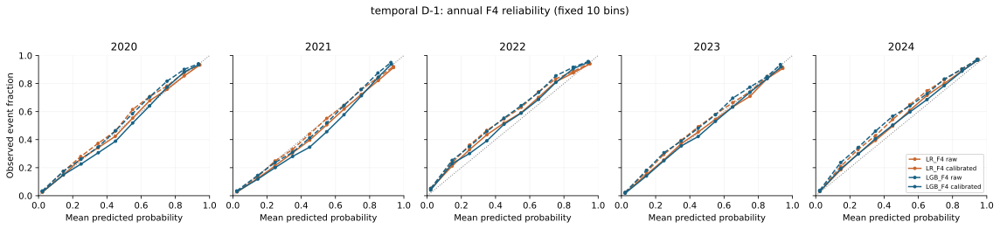
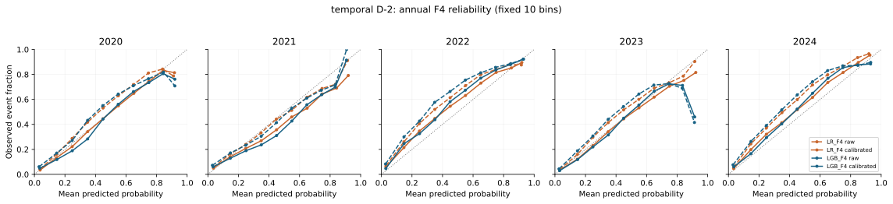
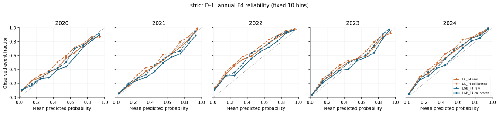
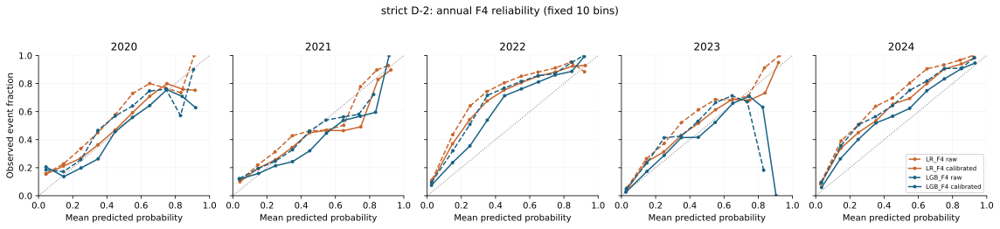

# 第四阶段冻结校准与正式评价结果

本报告仅整理已完成的冻结评价；不据测试成绩重选模型、特征或阈值。ERA5结果属于概率历史回报。

## 执行完成与数据分离

正式评价覆盖 104 个固定配置、520 份模型—年预测、10 份scope—年共同索引。2018—2019仅用于预定概率校准及告警规则，2020—2024用于一次正式评价。

strict结果来自H的165格空间留出；temporal来自全域1580格。两个scope的分布和样本不同，分数差不等于纯迁移损失。

## 固定复杂模型与最强简单对照

ΔBS=LightGBM_F4−LR_F4，负值表示树更好。区间为预定14日配对层级bootstrap的95%百分位区间；改善年数按五个年度单列。

| 范围 | lag | 风险集 | 树BS | LR BS | ΔBS | 95%区间 | 改善年数 |
| --- | --- | --- | --- | --- | --- | --- | --- |
| temporal | D−1 | all | 0.1063 | 0.1034 | 0.0029 | [0.0004, 0.0034] | 0/5 |
| temporal | D−1 | onset | 0.0861 | 0.0837 | 0.0024 | [0.0002, 0.0036] | 0/5 |
| temporal | D−2 | all | 0.1499 | 0.1419 | 0.0080 | [0.0033, 0.0128] | 0/5 |
| temporal | D−2 | onset | 0.1030 | 0.1013 | 0.0017 | [-0.0036, 0.0049] | 1/5 |
| strict | D−1 | all | 0.1311 | 0.1313 | -0.0002 | [-0.0092, 0.0070] | 2/5 |
| strict | D−1 | onset | 0.1254 | 0.1240 | 0.0014 | [-0.0042, 0.0056] | 2/5 |
| strict | D−2 | all | 0.1820 | 0.1836 | -0.0016 | [-0.0196, 0.0095] | 2/5 |
| strict | D−2 | onset | 0.1367 | 0.1331 | 0.0036 | [-0.0083, 0.0119] | 1/5 |

temporal 的跨lag/风险组稳定优势及应用扩展保守门：**未通过**。
全部逐cell判据与失败原因见 [application_gate.json](../data/probability_phase4/evaluation/application_gate.json)。整体门结论不抹去单项改善，也不构成部署许可。

strict 的跨lag/风险组稳定优势及应用扩展保守门：**未通过**。
全部逐cell判据与失败原因见 [application_gate.json](../data/probability_phase4/evaluation/application_gate.json)。整体门结论不抹去单项改善，也不构成部署许可。

## D−2新发生与湿度反例

onset风险集包含D−1未发生的全部格日（00及01）。下表保留纯湿度和状态条件增量；两者回答不同问题。验证期反例与正式期结果应同时解释，不凭次要正面结果改写主对照。

| 范围 | 对照 | ΔBS | 95%区间 | 改善年数 |
| --- | --- | --- | --- | --- |
| temporal | LGB moisture | 0.0006 | [-0.0012, 0.0031] | 2/5 |
| temporal | LGB conditional | 0.0000 | [-0.0012, 0.0020] | 2/5 |
| temporal | LR moisture | 0.0002 | [-0.0017, 0.0024] | 2/5 |
| temporal | LR conditional | 0.0006 | [-0.0010, 0.0032] | 1/5 |
| strict | LGB moisture | -0.0016 | [-0.0054, 0.0029] | 4/5 |
| strict | LGB conditional | -0.0003 | [-0.0035, 0.0039] | 3/5 |
| strict | LR moisture | -0.0013 | [-0.0066, 0.0036] | 4/5 |
| strict | LR conditional | -0.0007 | [-0.0042, 0.0028] | 4/5 |

## 校准及基线

104份映射记录状态：`{"fitted": 100, "persistence_raw": 4}`。持续性保留原始0/1，不参与概率映射。校准期诊断为样本内结果。

| 范围 | lag | 配置 | 原始BS | 校准BS | 原始AP |
| --- | --- | --- | --- | --- | --- |
| temporal | 1 | persistence | 0.1589 | 0.1589 | 0.6329 |
| temporal | 1 | seasonal | 0.1879 | 0.1731 | 0.6071 |
| temporal | 1 | seasonal_pooled | 0.2202 | 0.2096 | 0.4182 |
| temporal | 1 | transition | 0.1331 | 0.1302 | 0.6783 |
| temporal | 1 | logistic_F0 | 0.1270 | 0.1222 | 0.7797 |
| temporal | 1 | logistic_F4 | 0.1034 | 0.1026 | 0.8336 |
| temporal | 1 | lightgbm_F4 | 0.1063 | 0.1051 | 0.8295 |
| temporal | 2 | persistence | 0.2125 | 0.2125 | 0.5379 |
| temporal | 2 | seasonal | 0.1879 | 0.1731 | 0.6071 |
| temporal | 2 | seasonal_pooled | 0.2202 | 0.2096 | 0.4182 |
| temporal | 2 | transition | 0.1666 | 0.1608 | 0.5906 |
| temporal | 2 | logistic_F0 | 0.1541 | 0.1473 | 0.6796 |
| temporal | 2 | logistic_F4 | 0.1419 | 0.1387 | 0.7060 |
| temporal | 2 | lightgbm_F4 | 0.1499 | 0.1449 | 0.6815 |
| strict | 1 | persistence | 0.1962 | 0.1962 | 0.6590 |
| strict | 1 | seasonal | 0.2788 | 0.2430 | 0.5510 |
| strict | 1 | seasonal_pooled | 0.2788 | 0.2430 | 0.5510 |
| strict | 1 | transition | 0.1661 | 0.1593 | 0.7023 |
| strict | 1 | logistic_F0 | 0.1574 | 0.1443 | 0.7907 |
| strict | 1 | logistic_F4 | 0.1313 | 0.1281 | 0.8387 |
| strict | 1 | lightgbm_F4 | 0.1311 | 0.1296 | 0.8265 |
| strict | 2 | persistence | 0.2469 | 0.2469 | 0.5933 |
| strict | 2 | seasonal | 0.2788 | 0.2430 | 0.5510 |
| strict | 2 | seasonal_pooled | 0.2788 | 0.2430 | 0.5510 |
| strict | 2 | transition | 0.2030 | 0.1882 | 0.6429 |
| strict | 2 | logistic_F0 | 0.1958 | 0.1728 | 0.7096 |
| strict | 2 | logistic_F4 | 0.1836 | 0.1703 | 0.7273 |
| strict | 2 | lightgbm_F4 | 0.1820 | 0.1718 | 0.6903 |

其余全部特征臂、单类转换、子区、面积权重、7/21日敏感性及逐次删年结果均在机器表中保留；上述展示清单在开封前固定，并非测试最优排序。

## 逐年可靠性

每图五年独立显示固定十箱。空箱留空，不插值；计数、事件率和年度等权汇总见可靠性CSV。

## 可复现文件与边界

- [冻结协议](PROBABILITY_PHASE4_PROTOCOL.md)、[复现命令](PROBABILITY_PHASE4_REPRODUCE.md)、[模型说明](PROBABILITY_MODEL_CARD.md)。
- [逐年分数](../data/probability_phase4/evaluation/annual_scores.csv)、[汇总分数](../data/probability_phase4/evaluation/aggregate_scores.csv)、[配对差](../data/probability_phase4/evaluation/comparisons.csv)。
- [配对区间](../data/probability_phase4/evaluation/bootstrap_intervals.csv)、[逐次删年](../data/probability_phase4/evaluation/leave_one_year_out.csv)、[逐年可靠性](../data/probability_phase4/evaluation/reliability.csv)。
- [告警汇总](../data/probability_phase4/evaluation/aggregate_alert_metrics.csv)、[实际运行收据](../data/probability_phase4/evaluation/run_summary.json)。

逐样本raw/calibrated预测保留在本地NPZ，连接年度时间/网格字典即可恢复含时区、lag及可用时间的明细。大数组不进入轻量Git备份，产物哈希用于复现核验。

只有五个正式测试年份；2000次重采样不能创造独立年份。区间条件于已冻结模型与校准参数，单一H的时间区间不是跨未知地区的空间置信区间。

此前工作接触过2017/2022案例，本轮不能称全新盲测。ERA5同化与发布限制仍在，D−2不保证消除未来信息。ESG用途仅为气候危害筛查和适应信息，不能替代厂内热暴露、职业安全标准或财务损失模型。
