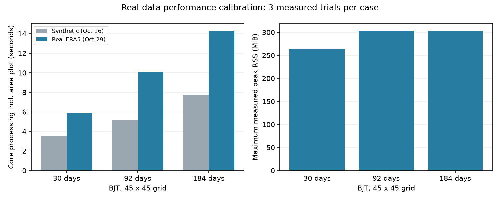

# Real-data calibration and acceptance — 2026-10-29

Production source: `38af41caaefe23d24c55f28bb021a121f9d56a5e`. Output review base: `503432787bce183b2800e6c746b6f349eaeab3b3`. Source/configuration/tests/dependencies are unchanged between these commits. The historical 120-file source snapshot was verified against its saved SHA-256 manifest before execution.

## M1-D: measured real-data performance

Existing reviewed benchmark harness; isolated output directories and fresh subprocesses; one warmup then three measured attempts per case. Raw inputs are read-only. Same five production entry points as the synthetic benchmark, including the risk area plot, excluding other maps/city plots. OS cache was not cleared; threads were limited to one. Bounds: 1 GiB RSS/commit, 600 seconds per child, 2 GiB per measurement directory; no limit was reached.

| Real BJT input | Days | Processing seconds median (range) | Child wall seconds median | Max RSS MiB | Read/decode seconds median |
|---|---:|---:|---:|---:|---:|
| June 2003 | 30 | 5.911 (5.757–6.001) | 11.302 | 263.6 | 4.519 |
| JJA 2003 | 92 | 10.108 (10.093–10.229) | 15.907 | 302.4 | 7.346 |
| JJA 2003–2004 | 184 | 14.323 (13.355–14.455) | 19.308 | 303.9 | 10.546 |

Twelve attempts passed, including three warmups. Inputs and source hashes remained unchanged; numeric products were byte-identical across attempts. The three real-data cases reproduce corresponding arrays from the full BJT production run exactly (temperature, humidity/heat index, risk/mask and per-year climatology).

The synthetic comparison uses the earlier 2003/2004 cases and identical scientific source. Input values, compression and run date differ; this is a calibration comparison, not a controlled compression-only experiment. Read/decode timing includes initial backend setup and repeated raw reads; process peaks include imports, hashing and validation.

### Exclusive stage medians (seconds)

| Case | Read/decode | Conversion | Hourly indices | Daily aggregation | Risk classification | Area fractions | NetCDF + CSV write | Area plot | Other |
|---|---:|---:|---:|---:|---:|---:|---:|---:|---:|
| month | 4.519 | 0.006 | 0.274 | 0.068 | 0.004 | 0.175 | 0.079 | 0.245 | 0.504 |
| summer | 7.346 | 0.023 | 0.954 | 0.186 | 0.005 | 0.604 | 0.099 | 0.257 | 0.600 |
| two-summers | 10.546 | 0.033 | 1.333 | 0.320 | 0.006 | 0.962 | 0.117 | 0.207 | 0.641 |

Conditional 25-summer core-processing estimate: 111.8 seconds using the one/two-summer increment, or 246.7 seconds if restarting each summer (numerical work only). These are different assumptions, not measured bounds or a guarantee. Full 25-summer processing already succeeded, but its peak memory and full-CLI runtime were not instrumented. No memory extrapolation, download-worker adjustment or production optimization follows from this benchmark.

## M1-C: real input and output acceptance

Input evidence is reused from the immediately preceding production run: 101 BJT inputs / 76 UTC inputs, 75 logical months and 2,300 days per configuration, all PASS. All 101 input hashes were checked again after this acceptance.

The new independent audit does not call production time aggregation or humidity helpers. For each of 150 local month blocks (75 per day definition), it constructs the exact UTC hourly calendar, concatenates only required previous-month/May edge hours, checks timestamps, reshapes to 24 hours per day, and directly recomputes daily Tmax and daily mean RH. This covers every season edge, month seam and leap-year summer. It also verifies all four city grid selections and CSV values against the corresponding complete daily arrays.

- jja_2000_2024_bjt: PASS; largest absolute raw-derived differences: `{'tmax_c': 0.0, 'mean_rh_percent': 0.0}`. Tolerances: 1e-6 C for Tmax; 2e-5 percentage points for mean RH (float32 rounding).
- jja_2000_2024: PASS; largest absolute raw-derived differences: `{'tmax_c': 0.0, 'mean_rh_percent': 0.0}`. Tolerances: 1e-6 C for Tmax; 2e-5 percentage points for mean RH (float32 rounding).

The earlier production-output audit additionally verifies heat-index risk thresholds, independently weighted area shares, 100% valid land coverage, exact per-year climatology mapping and zero July 2022 CSV differences. This audit does not independently rederive every hourly heat-index value: formula correctness still relies on the previously reviewed scientific tests. No tests were weakened and no full unit-suite rerun is claimed. Nonadjacent years are covered by the full 25-year audit; the performance two-summer case is adjacent 2003–2004 because the config accepts a first/last range, not an arbitrary year list.

Initial benchmark setup attempted a year list and exited before any processing; the supported range configuration was then used in new `*-r1` output directories. The initial failed setup directory remains preserved. No production code was changed to accommodate the benchmark.

## Evidence and review

Machine summary: [phase2_real_acceptance.json](phase2_real_acceptance.json). Performance details: [phase2_real_performance.json](phase2_real_performance.json). Full logs, environment, input/source hashes, trial measurements, audit script and configs remain in `D:\AS\ehhr-codex-output\real-validation-20261029`.

M1-D real-data calibration and the specified M1-C input/output acceptance are complete. The user reassigned review to Codex because CC was unavailable. The [supplementary author self-review](phase2_self_review.md) found no blocking issues; this is not independent reviewer or CC sign-off. The performance harness remains outside the repository pending a separate integration decision. No ML work, CDS request, push or merge was performed.
